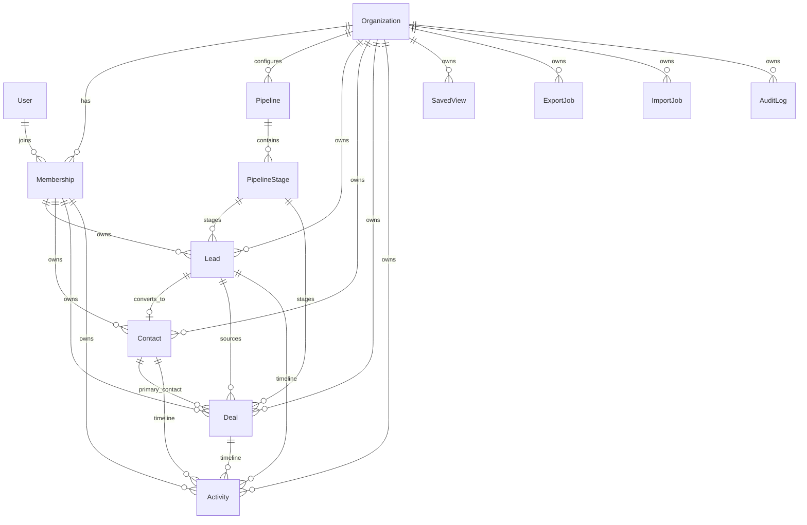

# Domain Model

Primary schema file: `prisma/schema.prisma`

Entity ownership map:

- `Organization`
  Prisma model: `prisma/schema.prisma` → `model Organization`
  Primary service: `src/services/organizationService.ts`
- `User`
  Prisma model: `prisma/schema.prisma` → `model User`
  Primary service: `src/services/authService.ts`
- `Membership`
  Prisma model: `prisma/schema.prisma` → `model Membership`
  Primary service: `src/services/organizationService.ts`
- `Invitation`
  Prisma model: `prisma/schema.prisma` → `model Invitation`
  Primary service: `src/services/organizationService.ts`
- `Pipeline`
  Prisma model: `prisma/schema.prisma` → `model Pipeline`
  Primary service: `src/services/pipelineService.ts`
- `PipelineStage`
  Prisma model: `prisma/schema.prisma` → `model PipelineStage`
  Primary service: `src/services/pipelineService.ts`
- `Lead`
  Prisma model: `prisma/schema.prisma` → `model Lead`
  Primary service: `src/services/leadService.ts`
- `LeadStatusHistory`
  Prisma model: `prisma/schema.prisma` → `model LeadStatusHistory`
  Primary service: `src/services/leadService.ts`
- `Contact`
  Prisma model: `prisma/schema.prisma` → `model Contact`
  Primary service: `src/services/contactService.ts`
- `Deal`
  Prisma model: `prisma/schema.prisma` → `model Deal`
  Primary service: `src/services/dealService.ts`
- `DealStageHistory`
  Prisma model: `prisma/schema.prisma` → `model DealStageHistory`
  Primary service: `src/services/dealService.ts`
- `Activity`
  Prisma model: `prisma/schema.prisma` → `model Activity`
  Primary service: `src/services/activityService.ts`
- `SavedView`
  Prisma model: `prisma/schema.prisma` → `model SavedView`
  Primary service: `src/services/savedViewService.ts`
- `ExportJob`
  Prisma model: `prisma/schema.prisma` → `model ExportJob`
  Primary service: `src/services/exportService.ts`
- `ImportJob`
  Prisma model: `prisma/schema.prisma` → `model ImportJob`
  Primary service: `src/services/importService.ts`
- `AsyncJob`
  Prisma model: `prisma/schema.prisma` → `model AsyncJob`
  Primary service: `src/services/jobService.ts`
- `AuditLog`
  Prisma model: `prisma/schema.prisma` → `model AuditLog`
  Primary service: `src/services/auditService.ts`
- `AssignmentHistory`
  Prisma model: `prisma/schema.prisma` → `model AssignmentHistory`
  Primary service: `src/services/leadService.ts` and `src/services/dealService.ts`

Why the `User` + `Membership` split matters:

- Identity is global in `model User`.
- tenant access is org-scoped in `model Membership`.
- org role lives on `Membership.role`, not `User`, which is why `src/lib/auth/session.ts` hydrates both user identity and active membership before `src/lib/middleware/withTenantGuard.ts` runs.
