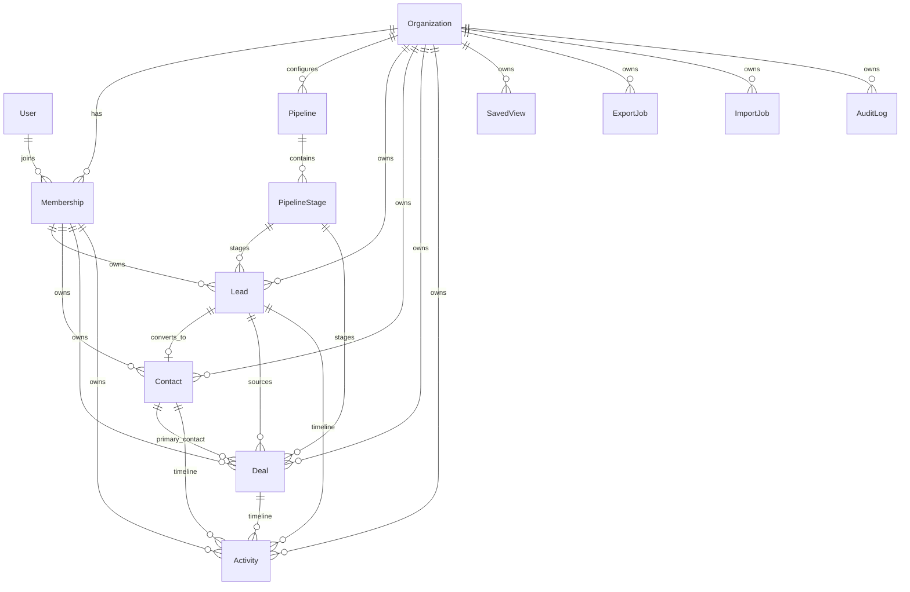

# Domain Model

Primary schema file: `prisma/schema.prisma` (645 lines, 20 models, 22 enums, PostgreSQL datasource at `:10-13`).

## Entity ownership map

| Model | Schema lines | Owning code | Has API route? |
|---|---|---|---|
| `Organization` | `schema.prisma:169-198` | `src/services/organizationService.ts` | yes (platform) |
| `User` | `:200-213` | `authService.ts`, `userRepository.ts` | indirectly (login, org creation) |
| `Membership` | `:215-249` | `organizationService.ts`, `membershipRepository.ts` | yes |
| `Invitation` | `:251-267` | `organizationService.inviteUser()` | create + list only |
| `Pipeline` | `:269-285` | `pipelineService.ts` | read only (`/api/pipelines`) |
| `PipelineStage` | `:287-310` | `pipelineService.ts` | read only |
| `Company` | `:312-332` | none | no |
| `Lead` | `:334-373` | `leadService.ts` | yes |
| `Contact` | `:375-402` | `contactService.ts`, `leadService.convertLead()`, `jobService` CSV import | yes |
| `Deal` | `:404-438` | `dealService.ts` | yes |
| `Activity` | `:440-471` | `activityService.ts` | yes |
| `SavedView` | `:473-492` | `savedViewService.ts` | create + list |
| `ExportJob` | `:494-517` | `exportService.ts`, `jobService.ts` | yes |
| `ImportJob` | `:519-535` | `importService.ts`, `jobService.ts` | yes |
| `Attachment` | `:537-556` | none | no |
| `AuditLog` | `:558-575` | `auditService.ts` | exposed via `/api/org/me` |
| `AssignmentHistory` | `:577-593` | `leadService.createLead()`, `createDealInTransaction()` | no (write-only) |
| `LeadStatusHistory` | `:595-609` | `leadService.ts` | returned inside lead detail only |
| `DealStageHistory` | `:611-627` | `dealService.ts` | returned inside deal detail only |
| `AsyncJob` | `:629-645` | `jobService.ts` | processed by `/api/jobs/process-due` |

Two models, `Company` and `Attachment`, have no service, repository or route. Leads, contacts, deals and activities can point at a `companyId`, but nothing in `src/` creates a `Company` row; the seed does not create one either (`prisma/seed.ts:69-320`). Treat `Company` as a planned feature whose foreign keys are already live.

## Why the `User` + `Membership` split matters

- Identity is global in `model User`; `email` is the only unique key (`schema.prisma:202`).
- Tenant access is org-scoped in `model Membership`, with `@@unique([organizationId, userId])` (`:247`) so a user has at most one membership per org.
- Org role lives on `Membership.role` (`:219`), not on `User`. The only role on `User` is `platformRole` (`:205`), which is how platform administration is kept separate from tenant administration.
- This is why `src/lib/auth/session.ts:75-92` hydrates both user identity and the active membership before `src/lib/middleware/withTenantGuard.ts` runs.
- Almost every "who did this" column points at `Membership`, not `User`: `createdByMembershipId`, `ownerMembershipId`, `changedByMembershipId`. The audit log keeps both (`actorUserId` and `actorMembershipId`, `:561-562`) because a user can act in several orgs.

## Tenant key coverage

Every tenant-owned model has a non-null `organizationId` with `onDelete: Cascade` back to `Organization`, except:

- `AuditLog.organizationId` is optional (`:560`) so that platform events (written by `auditService.logPlatformEvent`, `src/services/auditService.ts:21-30`) can exist without a tenant.
- `AsyncJob.organizationId` is optional (`:631`) for the same reason, though every enqueue site in this code sets it.
- `User` has no tenant key by design.

Indexes lead with `organizationId` on the hot list queries: `Lead @@index([organizationId, status, ownerMembershipId])` (`:370`), `Deal @@index([organizationId, pipelineId, stageId])` (`:436`), `Activity @@index([organizationId, dueAt])` (`:470`). The lead list query orders by `createdAt desc` (`src/repositories/leadRepository.ts:22`) and the only lead index containing `createdAt` is `[organizationId, source, createdAt]` (`:372`), so an unfiltered tenant lead list has no index that serves its sort.

## Uniqueness rules and what they do at runtime

| Constraint | Line | Runtime effect in this code |
|---|---|---|
| `Organization.slug @unique` | `:172` | duplicate slug on `POST /api/platform/organizations` throws Prisma `P2002`, returned as 500 (`responses.ts:50-58`) |
| `Invitation @@unique([organizationId, email, status])` | `:265` | a second `PENDING` invite to the same email throws `P2002` → 500; once invitations can be `REVOKED`, only one revoked row per email is allowed either |
| `Invitation.token @unique` | `:258` | tokens are `crypto.randomUUID()` (`organizationService.ts:162`) |
| `Pipeline @@unique([organizationId, key])` | `:283` | `provisionDefaultPipeline` is idempotent by checking `findDefault` first (`pipelineService.ts:24-29`), not by relying on this |
| `PipelineStage @@unique([pipelineId, position])` | `:308` | reordering stages would need a two-step update; no code does it yet |
| `Company @@unique([organizationId, name])` | `:330` | unused (no Company writes) |
| `Contact.sourceLeadId @unique` | `:381` | converting a lead twice is blocked in the service (`leadService.ts:221-223`); a manual `POST /api/contacts` with an already-used `sourceLeadId` hits the DB constraint → 500 |
| `SavedView @@unique([organizationId, ownerMembershipId, resource, name])` | `:490` | duplicate view name per owner → 500 |

## State fields and who changes them

- `Lead.status` (`LeadStatus`, `:51-58`): changed only by `leadService.transitionStatus()` and `convertLead()`, both writing a `LeadStatusHistory` row. The allowed-transition table is code, not schema (`src/services/leadService.ts:19-26`).
- `Deal.status` (`DealStatus`, `:93-98`): derived from the target stage's `isClosed`/`isWon` flags (`dealService.ts:86-90`, `:138`), never set directly by a client. `ARCHIVED` is in the enum but no code path sets it.
- `Deal.value` is `Decimal(12, 2)` (`:416`) and is written via `new Prisma.Decimal(input.value)` (`dealService.ts:143`). Prisma returns `Decimal` objects as strings in JSON, which is why `DealRow.value` is typed `string | number` (`src/types/api.ts:51`).
- `Activity.status` (`ActivityStatus`, `:108-112`) defaults to `OPEN`; no route ever changes it, and `completedAt` is never written. Two "overdue" definitions exist: the dashboard uses `status: OPEN` (`src/services/reportingService.ts:52-58`) while `activityService.listActivities` and the unused `activityRepository.countOverdue` use `completedAt: null` (`activityService.ts:34-35`, `activityRepository.ts:49-57`). They agree today only because nothing completes activities.
- `AsyncJob.status`: `QUEUED → RUNNING → SUCCEEDED | FAILED`, written by `jobService.processDueJobs()` (`src/services/jobService.ts:24-28`, `:112-115`, `:119-123`). Nothing moves a `FAILED` job back to `QUEUED`, so `attempts` (`:638`) only ever reaches 1.

## Invariants the schema does not enforce

1. **Same-tenant references.** `Lead.companyId`, `Contact.sourceLeadId`, `Deal.primaryContactId`, `Activity.leadId` and similar columns reference rows by id only. Nothing (schema or service) guarantees the referenced row has the same `organizationId`. See finding 2 in `docs/architecture/auth-and-tenant-isolation.md`.
2. **Stage belongs to the record's pipeline.** Enforced in services (`leadService.ts:106-108`, `dealService.ts:82-84`, `:134-136`), not by a composite foreign key.
3. **At least one active admin per org.** Enforced by a non-transactional count in `organizationService.updateMembership()` (`:198-211`), not by the database.
4. **Activities have a parent.** Enforced only by Zod `.refine` (`src/lib/validation/activitySchemas.ts:26-28`); a direct Prisma write can create an orphan.

## Exercises

1. **Goal:** find the unused models. **Check:** grep `src/` for `prisma.company`, `db.company`, `attachment.` and `db.attachment`. Zero hits confirms `Company` and `Attachment` have no write path.
2. **Goal:** see a `P2002` become a 500. **Check:** as an org admin, `POST /api/org/invitations` with the same email twice. Predict the second response (`500`, `error.code` = `internal_server_error`) from `schema.prisma:265` and `responses.ts:50-58`, then confirm it.
3. **Goal:** reason about the overdue mismatch. **Check:** write down which two counts would diverge if you added a "complete activity" endpoint that sets `completedAt` but leaves `status: OPEN`. (Answer: the dashboard keeps counting it; the activity list's `overdueOnly` filter drops it.)
4. **Goal:** design the missing index. **Check:** write the `@@index` you would add for `leadRepository.list` ordered by `createdAt desc` within a tenant, and explain why `[organizationId, createdAt]` serves the sort better than the existing `[organizationId, source, createdAt]` when no `source` filter is present.
